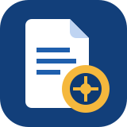
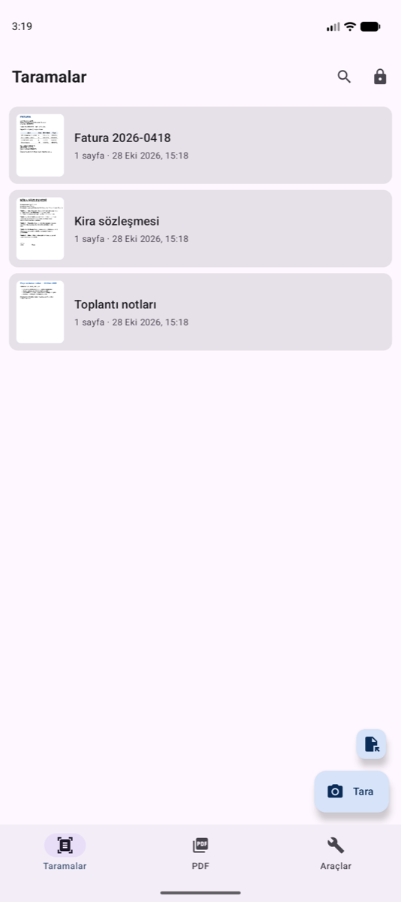
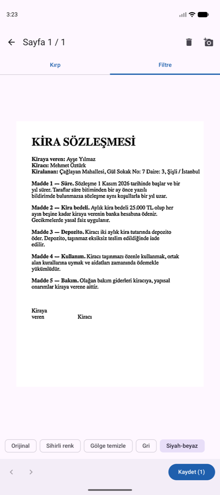
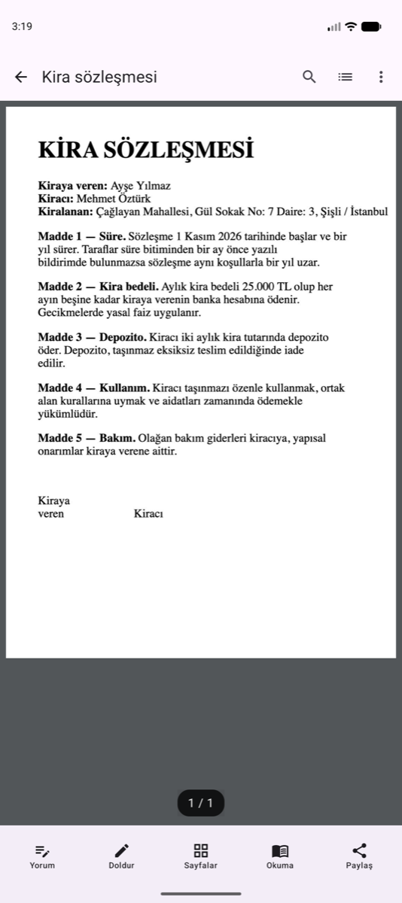
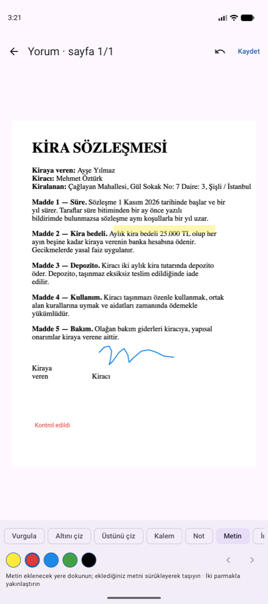
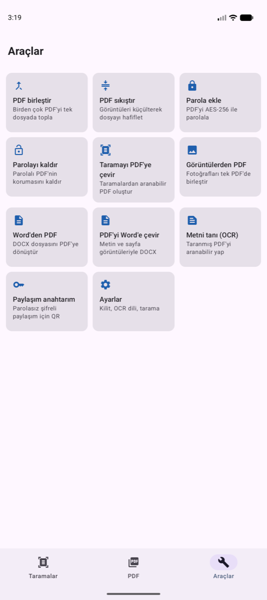
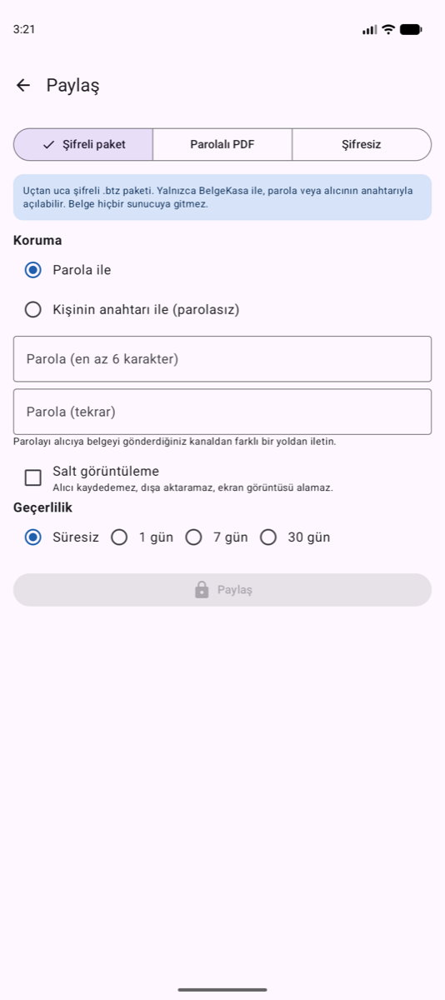
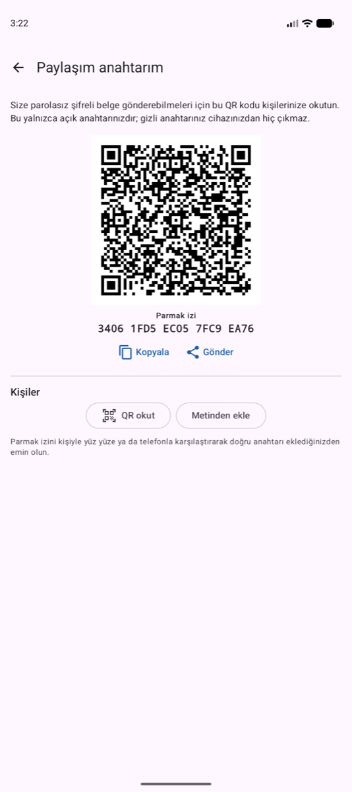
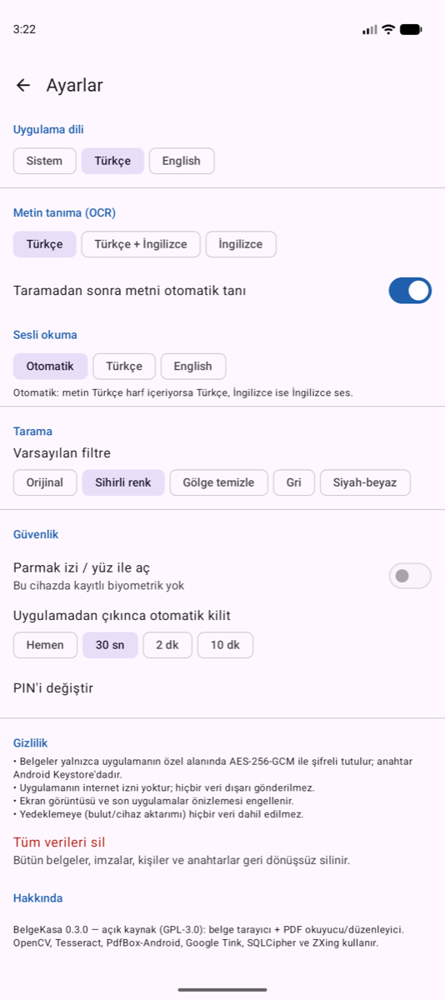

<p align="center">
  
</p>

<h1 align="center">BelgeKasa</h1>

<p align="center">
  <b>Belgeleriniz telefonunuzda değil, kasada.</b><br>
  Ücretsiz ve açık kaynak belge tarayıcı + PDF okuyucu/düzenleyici. İnternet izni yok, reklam yok, hesap yok.
</p>

<p align="center">
  <a href="https://github.com/b11s3c/BelgeKasa/releases/latest"></a>
  
  <a href="LICENSE"></a>
  <a href="https://github.com/b11s3c/BelgeKasa/actions/workflows/ci.yml"></a>
</p>

<p align="center">
  <a href="https://github.com/b11s3c/BelgeKasa/releases/latest"><b>⬇️ APK'yı indir</b></a> ·
  <a href="#özellikler">Özellikler</a> ·
  <a href="#gizlilik-ve-güvenlik">Güvenlik</a> ·
  <a href="CONTRIBUTING.md">Katkıda bulun</a> ·
  <a href="#english">English</a>
</p>

---

Kimliğinizi, sözleşmenizi, faturanızı ya da bir kitap sayfasını tarayın; metni tanısın, aranabilir
PDF ya da Word yapsın, imzalayın, paylaşın. Bunların hepsi telefonunuzda, **çevrimdışı** olur:
taradığınız sayfalar galeriye ya da telefon hafızasına düşmez, uygulamanın **şifreli kasasında**
kalır. Paylaştığınız belge de yolda **uçtan uca şifreli** gider.

## Neden BelgeKasa?

- 🔒 **Şifreli kasa** — Sayfalar ve PDF'ler AES-256-GCM ile şifreli saklanır; anahtar telefonun
  güvenli donanımında (Android Keystore) durur. Galeriye, İndirilenler'e hiçbir şey yazılmaz.
- 📵 **İnternet izni yok** — Uygulama hiçbir sunucuya bağlanamaz. Reklam, izleme, hesap, bulut yok.
  Metin tanıma (OCR) dahil her şey cihazda çalışır.
- 🤝 **Şifreli paylaşım** — Belgeyi parolayla ya da kişinin QR anahtarıyla şifreleyip WhatsApp,
  e-posta, Bluetooth… ne isterseniz onunla gönderin; yalnızca alıcı açabilir. İsterseniz salt
  görüntüleme ve süre sınırı koyun.
- 💸 **Tamamen ücretsiz** — Abonelik yok, filigran dayatması yok, sayfa sınırı yok.
- 🧩 **Açık kaynak** — Kodun tamamı burada; herkes inceleyebilir, derleyebilir, geliştirebilir.
- 🇹🇷 **Türkçe ve İngilizce** — Arayüz iki dilde; Türkçe metin tanıma, ş/ı/ğ duyarsız arama.

## Ekran görüntüleri

<p align="center">
  
  
  
  
</p>
<p align="center">
  
  
  
  
</p>

## Özellikler

### 📷 Tarama
- Canlı kenar algılama, otomatik çekim (sabit tutunca kendisi çeker), flaş, yakınlaştırma
- Toplu tarama, galeriden ekleme, köşe tutamaçlı kırpma ve perspektif düzeltme
- 5 filtre: Orijinal, Sihirli renk, Gölge temizle, Gri, Siyah-beyaz — her sayfaya ayrı
- **Kimlik kartı modu** (ön + arka yüz tek A4 sayfada), **kitap modu** (çift sayfayı ikiye böler)

### 🔤 Metin tanıma ve arama
- Çevrimdışı OCR (Tesseract): Türkçe ve İngilizce
- Aranabilir PDF: görünmez metin katmanı, kelimeler doğru yerde seçilir
- Bütün belgelerde tam metin arama, Türkçe karakter duyarsız (`sisli` → *Şişli*)

### 📄 PDF okuyucu ve düzenleyici
- Şifreli PDF kitaplığı; başka uygulamalardan "BelgeKasa ile aç"
- Arama ve vurgulama, içindekiler, sayfaya git, gece modu, iki parmakla yakınlaştırma
- Vurgula, altını/üstünü çiz, kalem, not, metin, imza — standart PDF yorumları olarak, diğer PDF
  okuyucularda da görünür; eklenen metni ve imzayı sürükleyerek yerleştirin
- Form doldurma (Türkçe karakterli), sayfa döndür / sil / sırala / ayıkla / ekle
- Okuma modu ve sesli okuma (Türkçe / English / otomatik)

### 🛠️ Araçlar
- PDF birleştir, sıkıştır, parola ekle/kaldır (AES-256)
- Görüntülerden PDF, Word'den PDF, PDF'den Word, taramayı aranabilir PDF'ye çevir
- Dışa aktarma: PDF (A4/Letter, kalite seçimi, filigran, parola), DOCX, JPEG, TXT

### 🔐 Güvenlik
- PIN + parmak izi / yüz ile kilit, otomatik kilit, hatalı denemede bekleme süresi
- Ekran görüntüsü ve son uygulamalar önizlemesi engelli; yedeklemeye hiçbir veri girmez
- "Tüm verileri sil" ile her şey geri dönüşsüz silinir

## İndirme ve kurulum

1. [**Son sürüm**](https://github.com/b11s3c/BelgeKasa/releases/latest) sayfasından
   `BelgeKasa-<sürüm>.apk` dosyasını telefonunuza indirin.
2. Dosyaya dokunun. Android "bilinmeyen uygulamalar" iznini sorarsa, yalnızca dosyayı açtığınız
   uygulama (tarayıcı ya da Dosyalar) için izin verin.
3. İlk açılışta 4–8 haneli bir PIN belirleyin.

Gereksinim: Android 9 veya üstü, ARM işlemcili telefon (64 ve 32-bit; neredeyse bütün telefonlar).

### İndirdiğiniz APK'nın gerçekliğini doğrulama

Resmi APK'lar **yalnızca bu deponun [Releases](https://github.com/b11s3c/BelgeKasa/releases)
sayfasında** yayımlanır ve her zaman aynı anahtarla imzalanır. Başka bir yerden indirdiğiniz bir
"BelgeKasa" bu anahtarla imzalı değilse resmi sürüm değildir.

İmza sertifikasının SHA-256 parmak izi:

```
E6:01:76:28:4B:F9:FC:F9:FD:C1:0C:F1:09:A4:B3:0A:7B:76:9E:DE:98:95:AD:37:6C:48:78:D8:21:55:73:A9
```

Bilgisayarda kontrol etmek için (Android SDK build-tools):

```bash
apksigner verify --print-certs BelgeKasa-0.3.0.apk
```

Her sürümün dosya özeti (SHA-256) sürüm notlarında ve `SHA256SUMS.txt` dosyasında yazar.

## Gizlilik ve güvenlik

| | |
| --- | --- |
| **Saklama** | Sayfalar `filesDir/vault` altında Tink AES-256-GCM ile şifreli; anahtar seti Android Keystore'daki dışa aktarılamaz bir anahtarla sarılı. Belge adları, OCR metni ve meta veri SQLCipher ile şifreli veritabanında. |
| **Ağ** | Uygulamanın `INTERNET` izni yok; hiçbir veri dışarı gönderilemez. |
| **Paylaşım (`.btz`)** | 64 KiB parçalı AES-256-GCM. Parola modunda PBKDF2-HMAC-SHA256 (310.000 tur), kişiye özel modda HPKE (X25519). Başlık (salt görüntüleme, son geçerlilik) kurcalamaya karşı doğrulanır. |
| **Kilit** | PIN yalnızca arayüzü kilitler; kasa anahtarı cihaza bağlıdır, PIN'den türetilmez. |
| **Sınırlar** | Salt görüntüleme ve süre sınırı alıcının BelgeKasa uygulamasınca uygulanır; değiştirilmiş bir uygulamaya karşı kriptografik garanti değildir. |

Ayrıntılı teknik tasarım: [docs/PLAN.md](docs/PLAN.md). Güvenlik açığı bildirmek için:
[SECURITY.md](SECURITY.md).

## Kaynaktan derleme

Gereksinimler: JDK 17, Android SDK (platform 36). Gradle sarmalayıcısı gerekenleri kendisi indirir.

```bash
git clone https://github.com/b11s3c/BelgeKasa.git
cd BelgeKasa
./gradlew :app:testDebugUnitTest                 # birim testleri
./gradlew :app:assembleDebug                     # işlemci başına debug APK'lar
./gradlew -ParmUniversal :app:assembleRelease    # tek ARM APK (imza anahtarı yoksa imzasız)
```

Debug derlemelerinde geliştirme kolaylığı için ekran görüntüsüne izin verilir; release
derlemelerinde her zaman engellidir. Cihaz üstü testler ve geliştirme notları:
[docs/hafiza/](docs/hafiza/README.md).

## Katkıda bulunma

Hata bildirimi, öneri, çeviri ve kod katkısı memnuniyetle karşılanır. Depoyu **fork**'layıp
değişikliğinizi kendi kopyanızda yapın, sonra bir **Pull Request** açın; incelenip uygun görülürse
ana koda eklenir. Ayrıntılar: [CONTRIBUTING.md](CONTRIBUTING.md).

## Lisans

BelgeKasa [GNU GPL v3.0 veya sonrası](LICENSE) ile lisanslıdır: kodu kullanabilir, değiştirebilir ve
dağıtabilirsiniz; değiştirilmiş sürümü dağıtırsanız onun kaynak kodunu da aynı lisansla açmanız gerekir.

Kullanılan açık kaynak bileşenler: OpenCV, Tesseract4Android ve tessdata (Apache-2.0),
PdfBox-Android (Apache-2.0), Google Tink (Apache-2.0), SQLCipher (BSD), ZXing (Apache-2.0),
Android Jetpack (Apache-2.0), Noto Sans yazı tipi (SIL OFL 1.1).

---

## English

**BelgeKasa** ("document vault") is a free, open-source **document scanner and PDF reader/editor**
for Android that keeps your documents in an **encrypted vault** instead of your phone's storage.
It has **no internet permission**: no ads, no tracking, no accounts, no cloud. Everything,
including text recognition, runs on the device.

- **Scan:** live edge detection, auto capture, batch scanning, crop and perspective fix, 5 filters,
  ID card mode (front + back on one page), book mode (splits a two-page spread)
- **Text:** offline OCR (Turkish, English), searchable PDFs, full-text search across documents
- **PDF:** encrypted PDF library, search, contents, night mode, highlights / pen / notes / text /
  signatures saved as standard PDF annotations, form filling, page organiser, reading mode and
  read-aloud
- **Tools:** combine, compress, add/remove password, images/Word to PDF, PDF to Word
- **Sharing:** end-to-end encrypted `.btz` packages, opened with a password or the recipient's QR
  key, optional view-only and expiry; or password-protected PDF
- **Security:** PIN + biometric lock, auto-lock, screenshots blocked, excluded from backups
- **Languages:** the interface is available in Turkish and English

**Download:** get `BelgeKasa-<version>.apk` from the
[latest release](https://github.com/b11s3c/BelgeKasa/releases/latest) (Android 9+, ARM phones).
Official builds are published only here and are signed with the certificate whose SHA-256 is
`E6:01:76:28:4B:F9:FC:F9:FD:C1:0C:F1:09:A4:B3:0A:7B:76:9E:DE:98:95:AD:37:6C:48:78:D8:21:55:73:A9`.

**Contributing:** fork the repository, make your change on a branch and open a pull request — see
[CONTRIBUTING.md](CONTRIBUTING.md). Security issues: [SECURITY.md](SECURITY.md).
**License:** [GPL-3.0-or-later](LICENSE).
